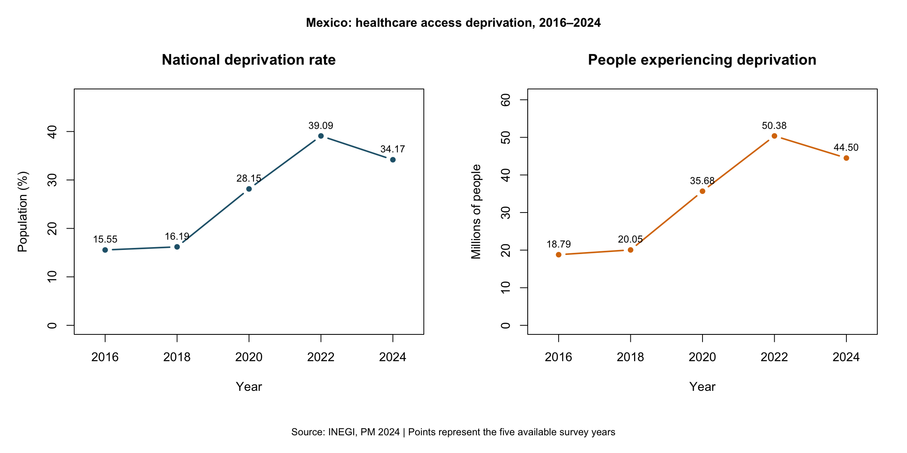
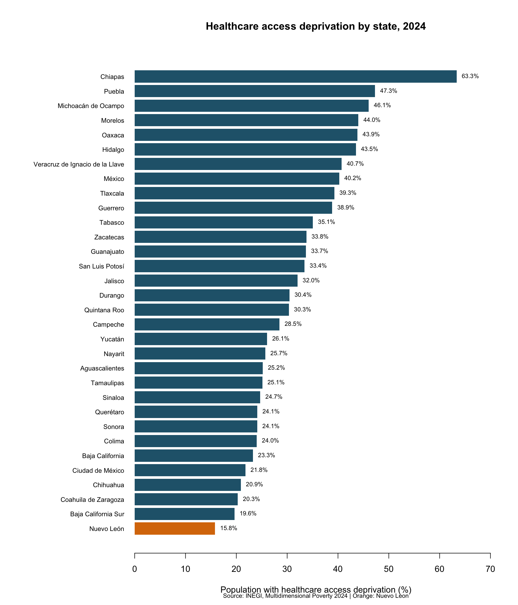
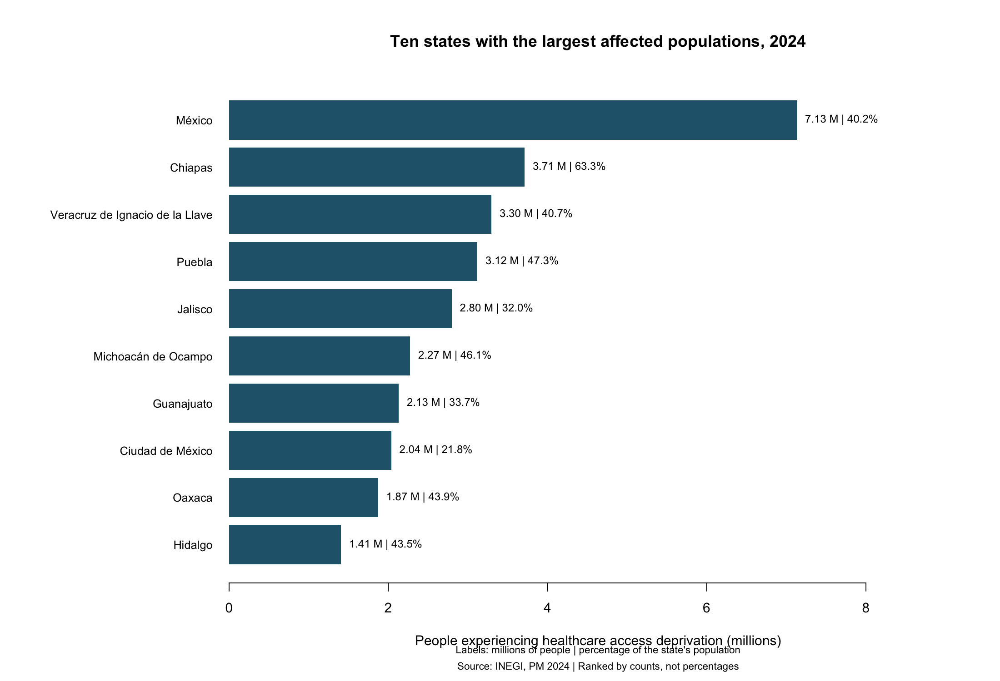
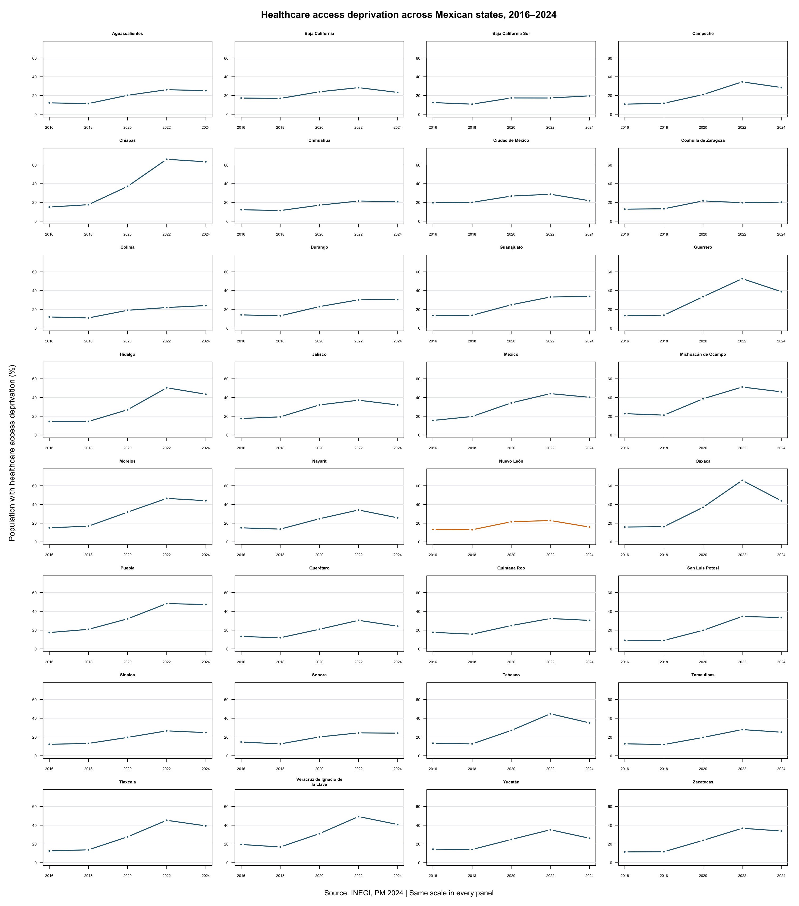
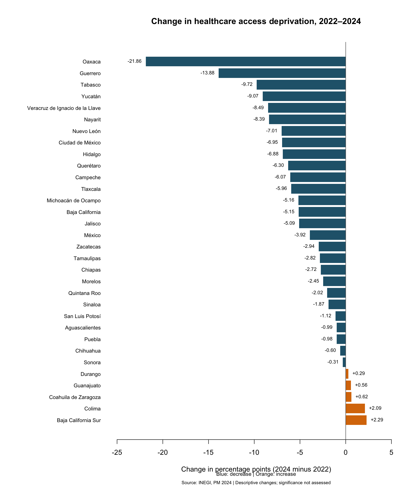
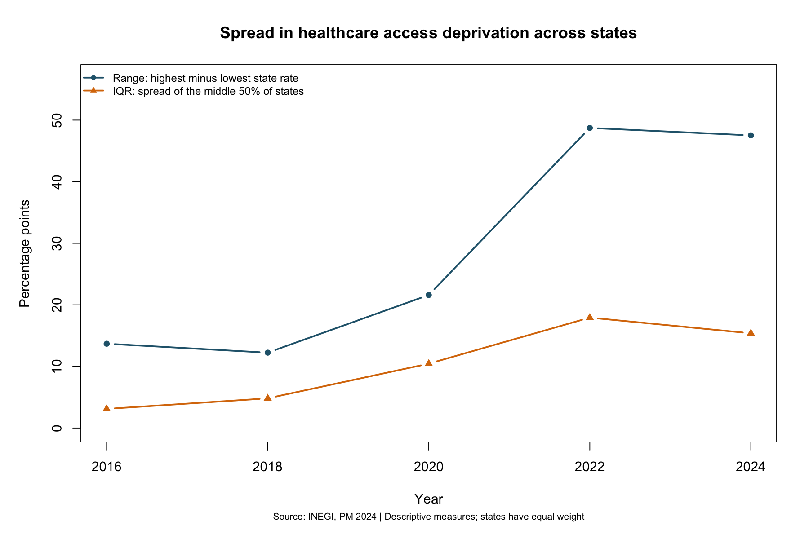

# mexico-healthcare-access-analysis
# Mexico Healthcare Access Analysis

An exploratory analysis of healthcare access deprivation across Mexico’s 32 states between 2016 and 2024, using official INEGI data.

I chose R because I wanted to practice statistical analysis with health-related public data. I used `readxl` to extract the Excel tables and base R to validate the data, compare estimates, and create charts. The project grew from an initial state comparison into a workflow that can regenerate the analysis from the original workbook.

## Objective

Describe how healthcare access deprivation differs across states, how the estimates changed over time, and how the picture differs when comparing percentages with population counts.

The analysis covers five years: **2016, 2018, 2020, 2022, and 2024**.

## Main findings

### Recent decreases did not return estimates to 2016 levels

Between 2022 and 2024, estimated deprivation decreased in **27 states** and increased in **5**.

However, all **32 states** had higher point estimates in 2024 than in 2016. This shows why a recent decrease should be interpreted alongside the longer time series.

For example, Nuevo León declined from **22.83% in 2022 to 15.82% in 2024**, but remained above its **13.32% estimate in 2016**.

### National estimates followed the same broad pattern

| Year | Population experiencing deprivation | Millions of people |
|---|---:|---:|
| 2016 | 15.55% | 18.79 |
| 2018 | 16.19% | 20.05 |
| 2020 | 28.15% | 35.68 |
| 2022 | 39.09% | 50.38 |
| 2024 | 34.17% | 44.50 |

From 2022 to 2024, the national estimate decreased by **4.92 percentage points**, equivalent to a net decrease of approximately **5.88 million people** in the estimated count.

These are changes in aggregate estimates, not a count of identified individuals moving into or out of deprivation.

### The highest percentage and largest population count occur in different states

| State | Deprivation rate in 2024 | Millions of people |
|---|---:|---:|
| Estado de México | 40.24% | 7.13 |
| Chiapas | 63.34% | 3.71 |
| Jalisco | 32.04% | 2.80 |
| Nuevo León | 15.82% | 0.97 |

Chiapas had the highest estimated rate, while Estado de México had the largest estimated number of people experiencing deprivation.

Nuevo León had the lowest rate among states, but still had approximately **970,000 people** experiencing this deprivation.

### Differences across states widened over the full period

| Measure | 2016 | 2022 | 2024 |
|---|---:|---:|---:|
| Highest minus lowest state rate | 13.69 pp | 48.73 pp | 47.52 pp |
| Interquartile range of state rates | 3.10 pp | 17.93 pp | 15.38 pp |

Both measures decreased between 2022 and 2024 but remained above their 2016 levels.

The range describes the distance between the two extremes. The interquartile range describes the spread of the middle 50% of states.

All findings are descriptive. Statistical significance and causes have not been established. Calculations use unrounded values; displayed results are rounded.

## Visualizations

### National trends

Percentages and population counts appear in separate panels because they have different units.



### State rates in 2024

Nuevo León is highlighted in orange.



### States with the largest affected populations

Bars are ranked by population count. Labels also show each state's deprivation percentage.



### State trajectories across all five years

All panels use the same scale to support comparison. Lines connect the available observations; they do not represent annual measurements.



### Changes from 2022 to 2024

Negative values indicate decreases; positive values indicate increases.



### Spread across states

These measures describe differences between state rates, giving each state equal weight.



## Data source and units

- **Publisher:** INEGI
- **Publication:** Multidimensional Poverty 2024
- **Workbook:** `pm_ef_2024.xlsx`
- **Indicator:** “Carencia por acceso a los servicios de salud”
- **Geographic coverage:** 32 states and the official national estimate
- **State dataset:** 160 observations, one per state and year
- **National dataset:** Five observations, one per year

[Download the original workbook](https://www.inegi.org.mx/contenidos/desarrollosocial/pm/tabulados/pm_ef_2024.xlsx)

State population counts are published in **thousands of people**. National counts are published in **millions**. The extraction preserves explicit unit names and converts state counts to millions for comparison.

Percentages are already expressed on a 0–100 scale.

The source workbook is excluded from Git. Save it locally as:

`data/raw/pm_ef_2024.xlsx`

## Methods and validation

The workflow:

1. Inspects workbook sheets, labels, headers, and units.
2. Extracts the healthcare indicator using its text label.
3. Checks year order, missing values, and percentage ranges.
4. Confirms unique state-year observations and complete five-year state series.
5. Joins observations by state and year.
6. Calculates changes in percentage points.
7. Compares state rates with the official national estimate.
8. Checks that state population counts sum to national totals.
9. Exports CSV files and generates charts.
10. Records execution metadata and R session information.

The population reconciliation matched the national totals in all five years, apart from negligible floating-point differences.

The scripts allow a difference of up to 100 people for rounding in published tables. This is a numerical consistency check, not a statistical test.

### Key calculations

**Change in percentage points = later percentage − earlier percentage**

**State gap from national rate = state percentage − national percentage**

A positive national gap means a state's point estimate exceeds the national estimate.

The national rate is extracted directly from the official table. It is not calculated as a simple average of state percentages.

## How to reproduce

Developed and successfully run on macOS using **R 4.6.1** and **readxl 1.5.0.1**.

### 1. Install the required package

In a terminal:

```bash
Rscript -e 'install.packages("readxl", repos="https://cloud.r-project.org")'
```

### 2. Download the source workbook

Create `data/raw/` if necessary and save the workbook as:

`data/raw/pm_ef_2024.xlsx`

### 3. Run the complete workflow

From the repository root:

```bash
Rscript run_analysis.R
```

The workflow runs seven analysis scripts in separate R processes and stops if a step fails.

Outputs are saved to:

- `data/processed/`: extracted data and comparison tables
- `reports/figures/`: six charts
- `reports/run_metadata.csv`: source MD5 fingerprint, readxl version, and execution time
- `reports/session_info.txt`: R session information

The metadata records the environment used; package versions are not yet pinned with a lockfile. Running the workflow again overwrites the generated outputs and execution records.

### macOS installation troubleshooting

During setup, compilation of `readxl` failed because the compiler could not locate the standard C++ header `set`.

After updating Apple Command Line Tools and confirming the header's location, the following command resolved installation on my computer:

```bash
CPLUS_INCLUDE_PATH="/Library/Developer/CommandLineTools/SDKs/MacOSX26.5.sdk/usr/include/c++/v1" Rscript -e 'install.packages("readxl", repos="https://cloud.r-project.org")'
```

The SDK path is specific to that installation. Check the installed SDK before using this workaround on another computer.

## Scripts

| Script | Purpose |
|---|---|
| `run_analysis.R` | Run the complete analysis and record execution information |
| `scripts/01_inspect_data.R` | Inspect the workbook and extract a Nuevo León example |
| `scripts/02_extract_healthcare_data.R` | Extract and validate state percentages |
| `scripts/03_plot_healthcare_access.R` | Plot the 2024 state comparison |
| `scripts/04_compare_years.R` | Compare and visualize 2022–2024 changes |
| `scripts/05_analyze_full_period.R` | Analyze five-year trajectories, dispersion, and 2016–2024 changes |
| `scripts/06_inspect_national_data.R` | Inspect national headers and units |
| `scripts/07_extract_national_data.R` | Extract national estimates and calculate state gaps |
| `scripts/08_extract_state_counts.R` | Extract state counts and reconcile national totals |
| `scripts/09_plot_national_and_counts.R` | Plot national trends and the ten largest affected populations |

Scripts 01 and 06 document the exploratory inspection and are excluded from the main workflow.

## Processed datasets

| File in `data/processed/` | Contents |
|---|---|
| `healthcare_access_states.csv` | State percentages for all five years |
| `healthcare_change_2022_2024.csv` | Recent state changes |
| `healthcare_change_2016_2024.csv` | Changes over the full period |
| `healthcare_yearly_summary.csv` | Annual cross-state dispersion summaries |
| `healthcare_national.csv` | Official national percentages and counts |
| `healthcare_states_vs_national.csv` | State differences from the national rate |
| `healthcare_states_with_counts.csv` | State percentages and population counts |
| `healthcare_population_reconciliation.csv` | State totals compared with national counts |

## Potential applications

The analysis can support a territorial diagnosis, provide context for research questions, or contribute evidence to a funding proposal.

Percentages help describe how widespread deprivation is within each state. Counts help describe the number of people affected. Both are useful when framing a problem, but neither alone determines where an intervention should be funded.

Resource allocation would also require information about local needs, existing services, intervention costs, and expected outcomes.

## Limitations

- The indicator does not directly measure healthcare quality, waiting times, treatment outcomes, or care received when needed.
- State averages conceal differences within states and across population groups.
- Sampling uncertainty and statistical significance have not been assessed. Rankings and changes refer to point estimates.
- Interpretation across years requires review of the indicator's methodological documentation and measurement context. This project has not completed that review.
- The analysis cannot establish causes or attribute changes to specific policies.
- The 160 state-year rows are repeated observations of 32 states, not 160 independent geographic units.
- Cross-state dispersion measures give each state equal weight. They do not measure inequality between individuals or municipalities.
- The workflow has been tested on the development computer, not across multiple operating systems.

## What I would improve next

**Review comparability and uncertainty.** The next analytical priority is to examine the methodological documentation across years and incorporate appropriate uncertainty estimates before making stronger claims about changes.

**Investigate differences within states.** Suitable disaggregated data could reveal differences between rural and urban areas and population groups that state averages hide.

**Add complementary indicators.** Healthcare infrastructure, service use, and income-based measures could provide context for exploratory associations. Multidimensional poverty requires particular care because healthcare deprivation is one of its components.

**Pin dependencies and test portability.** A dependency lockfile and automated execution in another environment would strengthen reproducibility beyond the current session records.

**Reduce repeated extraction code.** Shared helper functions could centralize sheet selection, header checks, and indicator extraction.

**Generate an integrated report.** A Quarto report could combine calculations, charts, and interpretation in a document regenerated by the workflow.

## Skills demonstrated

R programming, reusable functions, Excel ingestion, data cleaning, validation, table joins, descriptive statistics, visualization, workflow automation, source fingerprinting, and Git version control.